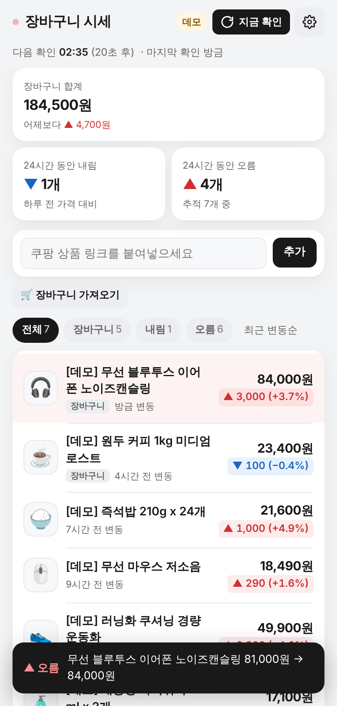
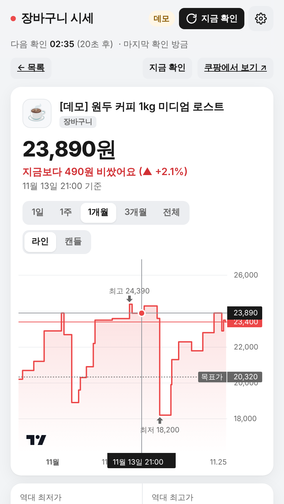
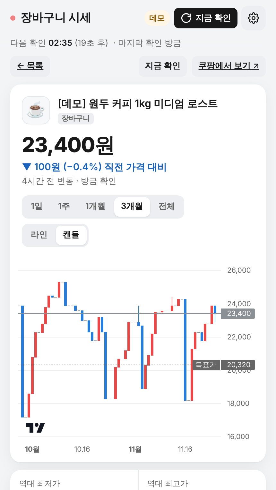

# 🛒 장바구니 시세

쿠팡 장바구니에 담아 둔 상품의 가격이 오르고 내리는 모습을 **주식 차트처럼** 보여주는 개인용 웹앱입니다.

| 목록 (관심종목처럼) | 상세 (라인 차트) | 캔들 차트 + 목표가 |
|---|---|---|
|  |  |  |

- **실시간 갱신** – 정해 둔 주기(기본 30분)마다 가격을 확인하고, 바뀌면 화면이 바로 갱신돼요 (새로고침 필요 없음).
- **주식형 차트** – 계단식 라인 / 캔들(시가·고가·저가·종가), 1일·1주·1개월·3개월·전체 기간, 차트 위에 손가락(마우스)을 올리면 그 시점 가격.
- **한국식 색** – 오름 ▲ 빨강, 내림 ▼ 파랑. 색만이 아니라 화살표와 부호로도 표시해요.
- **장바구니 가져오기** – 북마크 버튼 한 번으로 장바구니 전체를 가져오거나, 로그인된 브라우저로 자동 동기화.
- **목표가 알림** – "이 가격 이하가 되면" 알림. 차트에 점선으로 표시돼요.
- **역대 최저가 표시**, 최저가 대비 얼마나 비싼지, 기간 평균가, 전체 가격 기록 표.
- 휴대폰에서도 같은 와이파이라면 그대로 볼 수 있어요.

---

## 왜 "내 PC에서 실행"하나요?

- 쿠팡에는 장바구니를 읽어 올 수 있는 **공개 API가 없고**, 장바구니는 로그인해야 보여요.
- 쿠팡은 서버·클라우드에서 들어오는 자동 접속을 강하게 막아요(봇 차단).

그래서 이 앱은 **집 PC에서 작은 서버를 띄우고**, 필요하면 PC에 설치된 크롬/엣지로 쿠팡 페이지를 직접 열어 가격을 읽어요.
GitHub Pages 같은 정적 호스팅만으로는 동작하지 않아요.

## 준비물

- **Node.js 18 이상** – <https://nodejs.org> 에서 LTS 버전 설치
- **크롬 또는 엣지** (윈도우에는 엣지가 기본으로 있어요)

## 실행

```bash
cd coupang-tracker
npm install
npm start
```

화면에 나오는 주소로 접속하세요.

```
  🛒 장바구니 시세 v1.0.0
  PC에서 열기:        http://localhost:3000
  휴대폰에서 열기:    http://192.168.0.12:3000   (같은 와이파이)
```

> 윈도우에서 처음 실행할 때 방화벽 허용 창이 뜨면 **허용**을 눌러야 휴대폰에서 접속할 수 있어요.
> PC를 끄거나 창을 닫으면 그동안은 가격이 기록되지 않아요.

### 먼저 구경만 해 보기 (데모)

```bash
npm run demo
```

쿠팡에 접속하지 않고 가상의 상품 7개와 두 달치 가격으로 화면을 보여줘요. 20초마다 가격이 바뀌어서 실시간 갱신을 볼 수 있어요.

---

## 상품 넣는 방법 3가지

### 1. 링크 붙여넣기

쿠팡 상품 페이지 주소(또는 쿠팡 앱의 **공유 → 링크 복사**로 받은 글)를 입력칸에 붙여넣고 **추가**.
`coupang.com/vp/products/…`, `m.coupang.com/vm/products/…`, `link.coupang.com/a/…` 모두 돼요.

### 2. 북마크 버튼(북마클릿)으로 장바구니 통째로 가져오기 — 추천

앱에서 **🛒 장바구니 가져오기**를 누르면 방법이 나와요.

- **PC**: "🛒 시세에 담기" 버튼을 북마크바로 끌어다 놓고 → 쿠팡 장바구니에서 그 북마크를 클릭.
- **휴대폰**: 코드를 복사해 북마크 주소로 저장하고 → 휴대폰 브라우저(크롬·사파리)로 `m.coupang.com` 장바구니를 연 뒤 주소창에 북마크 이름을 입력해 실행.
  (쿠팡 **앱** 안에서는 안 돼요.)

장바구니에서 누를 때마다 그때의 가격이 기록되고, 상품 상세 페이지에서 누르면 그 상품 하나만 추가돼요.
내 브라우저에서 내가 보고 있는 화면을 읽는 방식이라 차단 걱정이 없어요.

### 3. 장바구니 자동 동기화

**설정 → 장바구니 자동 동기화**를 켜고 **쿠팡 로그인 창 열기**를 눌러 PC에 뜬 창에서 한 번 로그인하세요(로그인 정보는 이 폴더의 `data/browser-profile`에만 저장돼요).
그 뒤로는 확인 주기마다 장바구니를 직접 열어 새로 담은 상품은 추가하고, 빠진 상품은 "장바구니" 표시를 떼요.
장바구니 한 페이지로 모든 상품 가격을 읽으니 쿠팡에 주는 부담도 가장 적어요.

---

## 가격은 어떻게 확인하나요?

설정의 **가격을 가져오는 방법**:

| 방법 | 설명 |
|---|---|
| 자동 (기본) | 가벼운 "빠른 요청"을 먼저 쓰고, 쿠팡이 막거나 가격을 못 찾으면 브라우저로 확인해요. 한 번 막히면 6시간 동안은 바로 브라우저를 써요. |
| 빠른 요청만 | 브라우저 없이 페이지만 받아요. 가볍지만 자주 막혀요. |
| 브라우저만 | 크롬/엣지를 자동으로 열어 실제 화면에서 가격을 읽어요. 가장 확실해요. |

브라우저 확인이 "숨기기" 모드에서도 막히면 **브라우저 창: 보이기**로 바꿔 보세요. 확인용 창이 하나 열려 있게 되는데 최소화해 두면 돼요.

쿠팡 페이지 구조는 자주 바뀌어요. 그래서 알려진 가격 영역을 먼저 찾고, 없으면 **화면 위쪽에서 가장 크게 쓰인 가격 글자**를 고르는 규칙을 써요
(취소선 가격, 배송비, 쿠폰 할인액, "100g당 ○원" 같은 단위 가격, 아래쪽 추천 상품은 빼요).
장바구니에서는 수량이 2개 이상이면 합계가 아니라 **단가**를 골라요.

## 차트 보는 법

- **라인**: 가격이 바뀐 순간 계단처럼 꺾여요. 기간 동안 올랐으면 빨강, 내렸으면 파랑.
- **캔들**: 1일 보기는 1시간, 1주는 6시간, 그 이상은 하루 단위 봉. 빨강=그 구간에 오름, 파랑=내림, 회색=변동 없음.
- 차트에 손가락/마우스를 올리면 위쪽 큰 가격이 그 시점 가격으로 바뀌고, "지금보다 ○원 쌌어요/비쌌어요"를 알려줘요.
- **최저 / 최고** 표시와 **목표가** 점선이 함께 그려져요.
- 모든 값은 아래 **가격 기록** 표에서도 볼 수 있어요.

## 주의할 점

- 표시되는 가격은 **쿠팡 페이지에 보이는 가격**이에요. 쿠폰·카드 할인·와우 할인은 결제 단계에서 달라질 수 있어요.
- 너무 자주 확인하면 쿠팡이 접속을 막을 수 있어요. 최소 10분, **30분 이상 권장**. 상품 사이사이에도 몇 초씩 쉬어 가며 확인해요.
- 개인적인 가격 확인 용도로만 쓰세요. 쿠팡 이용약관에는 자동화된 접근에 관한 조항이 있을 수 있어요.
- 이 서버에는 로그인 기능이 없어요. **공유기 포트포워딩으로 인터넷에 공개하지 마세요.** 집 밖에서 보고 싶다면 Tailscale 같은 개인 VPN을 쓰세요.
  PC에서만 쓰려면 `HOST=127.0.0.1 npm start` (윈도우 PowerShell: `$env:HOST="127.0.0.1"; npm start`) 로 실행하면 같은 와이파이의 다른 기기도 접속할 수 없어요.

## 문제 해결

| 증상 | 해결 |
|---|---|
| "빠른 요청이 차단됨" | 정상이에요. 자동 모드라면 브라우저로 대신 확인해요. |
| "브라우저를 실행하지 못했어요" | 크롬이나 엣지를 설치하거나, `npx playwright-core install chromium` 실행 후 설정에서 "내장 크로미움" 선택. |
| "쿠팡이 자동 브라우저 접속도 막았어요" | 설정 → 브라우저 창 **보이기**, 확인 주기를 늘리기. |
| "페이지에서 가격을 찾지 못했어요" | 쿠팡 페이지 구조가 바뀐 경우예요. 그동안은 북마클릿으로 기록할 수 있어요. |
| "쿠팡 로그인이 필요해요" | 설정 → **쿠팡 로그인 창 열기** → 로그인 후 창 닫기. |
| 휴대폰에서 안 열려요 | PC와 같은 와이파이인지, 방화벽에서 Node.js를 허용했는지 확인. |

## 데이터

- 모든 기록은 `data/db.json` 한 파일에 저장돼요. 이 파일만 복사해 두면 백업이 돼요.
- 가격은 **바뀐 순간만** 기록하고 마지막 확인 시각은 따로 둬서 파일이 거의 커지지 않아요.

## 환경변수

| 이름 | 기본값 | 설명 |
|---|---|---|
| `PORT` | `3000` | 서버 포트 (`npm start -- --port 4000` 도 가능) |
| `HOST` | `0.0.0.0` | `127.0.0.1` 이면 이 PC에서만 접속 |
| `CPT_DATA_DIR` | `./data` | 데이터 폴더 |
| `CPT_BROWSER_PATH` | – | 크롬 실행 파일 경로를 직접 지정 |

## 개발

```bash
npm test          # 단위 테스트 (링크 해석, 가격 추출, 저장소)
npm run test:e2e  # 가짜 쿠팡 페이지 + 실제 브라우저로 끝에서 끝까지 테스트 (실제 쿠팡에는 접속 안 함)
```

```
server.js            HTTP 서버, API, 실시간 알림(SSE)
lib/tracker.js       주기적 확인, 가격 반영, 알림
lib/coupang.js       링크 해석, 빠른 요청, HTML에서 가격 추출
lib/browser.js       크롬/엣지 자동화 (상품 확인, 장바구니, 로그인 창)
lib/extractor.js     쿠팡 페이지 안에서 도는 추출 함수 (브라우저 자동화와 북마클릿이 함께 씀)
lib/store.js         JSON 파일 저장소
lib/demo.js          데모 데이터
public/              화면 (차트: TradingView lightweight-charts)
```
