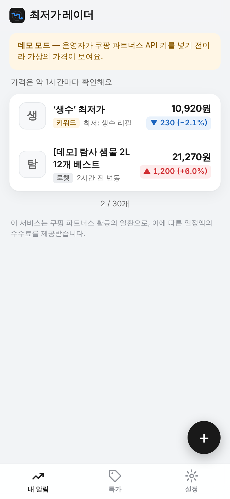
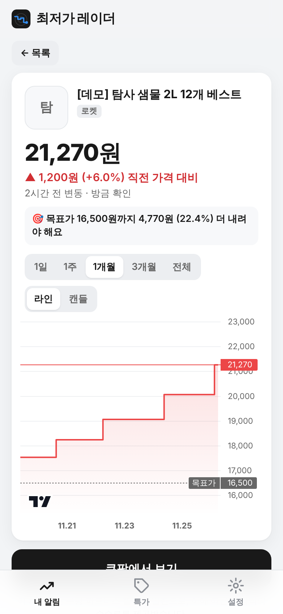
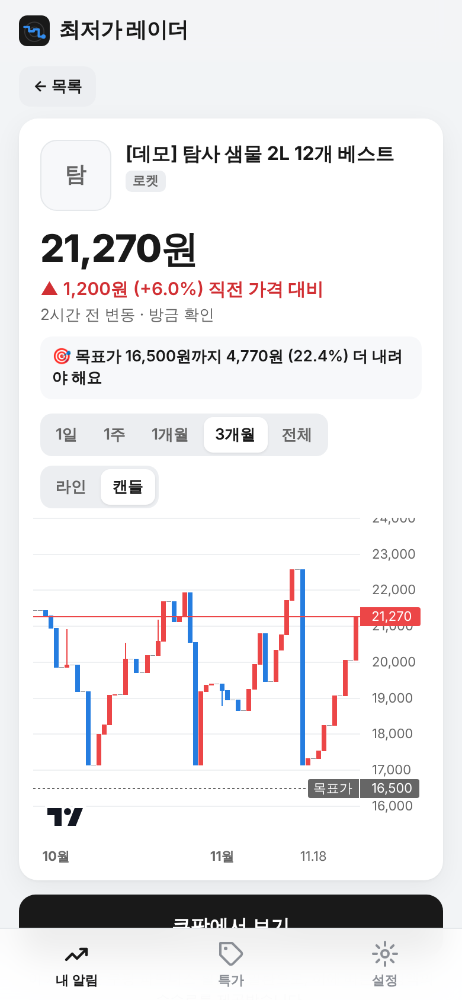
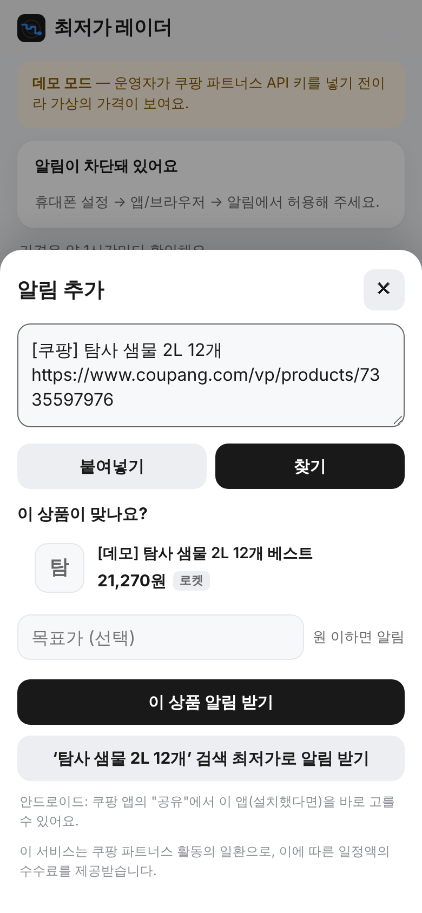

# 📡 최저가 레이더

쿠팡 상품이나 검색어를 등록해 두면 **서버가 알아서 가격을 확인**하고, 가격 변동을 **주식 차트처럼** 보여주며, 가격이 내리면 **휴대폰으로 알림**을 보내는 웹앱입니다.
PC 없이 휴대폰만으로 쓰고, 운영할 수 있어요. 모든 구매 링크는 **쿠팡 파트너스 링크**라서 사용자가 구매하면 수수료가 들어옵니다.

| 내 알림 | 상세(라인 차트 + 목표가) | 캔들 차트 | 추가하기 |
|---|---|---|---|
|  |  |  |  |

> 위 화면은 데모 데이터예요 (쿠팡 키를 넣기 전에는 가상 가격으로 동작).

## 할 수 있는 것

- **링크만 넣으면 자동 추적** – 쿠팡 앱에서 상품 → 공유 → 링크 복사 → 붙여넣기. 상품 이름만 입력해도 돼요.
  안드로이드에서는 앱을 설치하면 쿠팡 앱의 "공유" 목록에서 바로 이 앱을 고를 수 있어요.
- **키워드 최저가 알림** – "생수 2L"처럼 검색어를 등록하면 검색 결과 중 최저가를 추적해요.
- **주식형 차트** – 계단식 라인/캔들, 1일~전체 기간, 손가락을 올리면 그 시점 가격, 최저·최고 표시, 목표가 점선.
- **푸시 알림** – 목표가 도달 또는 가격 하락 시. 같은 상품은 6시간에 한 번까지(목표가 도달은 항상).
  밤 9시~아침 8시 알림은 아침에 모아서 보내요(사용자가 원하면 밤에도 바로).
- **오늘의 특가 / 카테고리 베스트** 목록에서 바로 알림 등록.
- **회원가입 없음** – 기기마다 익명 코드로 저장. 다른 기기로 옮길 때는 "내 기기 코드"를 입력.

## 동작 방식

```
휴대폰(웹앱) ──▶ Cloudflare Worker (무료, 24시간) ──▶ 쿠팡 파트너스 Open API
                     │  5분마다 깨어나서 확인할 차례인 상품만 조회
                     ├─ D1 데이터베이스: 알림 목록, 가격 기록(바뀐 순간만)
                     └─ 웹 푸시: 가격이 내리면 휴대폰으로 알림
```

### 꼭 알아야 할 한계

1. **쿠팡 파트너스 API에는 "링크로 바로 가격 조회" 기능이 없어요.**
   그래서 상품 이름으로 검색해 결과(최대 10개) 안에서 **같은 상품 번호**를 찾아 가격을 읽어요.
   검색 상위에 안 나오는 상품은 못 찾을 수 있고, 그러면 "검색에서 못 찾음"으로 표시돼요. 이럴 땐 비슷한 상품을 고르거나 키워드 알림을 쓰세요.
   색상·용량 같은 옵션별 가격이 아니라 대표 가격이에요.
2. **호출 한도가 있어요.** 비공식 자료에 따르면 1시간에 30회를 넘기면 24시간 정지, 3번 정지되면 계정 정지라고 해요.
   그래서 기본값은 **시간당 20회**이고, 그중 30%는 사용자가 직접 찾는 검색용으로 남겨 둬요. 정기 확인은 시간당 약 14회예요.
   같은 상품·검색어는 사용자가 몇 명이든 **한 번만** 조회하고, 한 번 검색으로 결과 안의 모든 추적 상품을 함께 갱신해요.

   | 추적 중인 상품·키워드 수 (전체 사용자 합) | 한 상품을 다시 확인하는 간격 |
   |---|---|
   | 14개 이하 | 약 1시간 |
   | 100개 | 약 7시간 |
   | 300개 | 약 하루 |

   사용자가 많아지면 쿠팡 파트너스 측에 한도 상향이 가능한지 문의해 보세요.
3. 가격은 파트너스 API가 주는 값이라 쿠폰·카드·와우 할인 등 실제 결제 금액과 다를 수 있어요.
4. API 키를 넣기 전에는 **데모 모드**(가상 가격)예요. 키를 넣으면 데모 데이터는 자동으로 지워져요.

## 휴대폰만으로 배포하기

### 가장 쉬운 방법: 배포 버튼

[](https://deploy.workers.cloudflare.com/?url=https://github.com/yongki6696/rsi-watch/tree/main/price-radar)

1. Cloudflare 에 로그인한 브라우저에서 위 버튼을 누르세요.
2. 처음이라면 **GitHub 연결(Connect GitHub)** 을 눌러 허용하세요. 이 앱이 **내 GitHub 에 새 저장소로 복사**되고, 그 저장소가 바뀌면 자동으로 다시 배포돼요.
3. 이름은 그대로 두고 **만들고 배포(Create and deploy)** 를 누르세요.
   데이터베이스(D1), 5분마다 도는 예약 작업, 푸시 알림 키가 모두 **자동으로** 준비돼요.
4. 끝나면 `https://<이름>.<계정이름>.workers.dev` 주소가 생겨요. 열면 **데모 모드**(가상 가격)로 동작해요.

### 직접 연결하는 방법

1. Cloudflare 대시보드 → **Workers & Pages → 만들기(Create)** → **저장소 가져오기(Import a repository)** → GitHub 연결 → 이 저장소 선택.
2. 프로젝트 이름 **`price-radar`** (`wrangler.jsonc` 의 `name` 과 같아야 해요), 루트 디렉터리(Root directory / Path) **`price-radar`**,
   빌드 명령은 비워 두고 배포 명령은 기본값(`npx wrangler deploy`), 브랜치는 이 코드가 있는 브랜치.
3. **배포** → 데이터베이스와 예약 작업, 알림 키가 자동으로 준비돼요.

### 명령어로 직접 배포하기 (개발자용)

```bash
npm install
CLOUDFLARE_API_TOKEN=<배포 권한 토큰> npm run deploy:cli
```

`wrangler.cli.jsonc` 를 쓰고, 화면 파일을 Worker 안에 묶어서 올려요(`npm run build:inline`).
토큰에는 Workers Scripts 편집, D1 편집, Account Settings 읽기 권한이 필요해요.

### 배포한 뒤

1. **쿠팡 키 넣기**(키를 발급받으면): Cloudflare → 내 Worker → **설정(Settings) → 변수 및 비밀(Variables and Secrets)** → **추가(Add)**,
   종류는 꼭 **비밀(Secret)** 로 (텍스트로 넣으면 다음 배포 때 지워질 수 있어요):

   | 이름 | 값 |
   |---|---|
   | `COUPANG_ACCESS_KEY` | 쿠팡 파트너스 Access Key |
   | `COUPANG_SECRET_KEY` | 쿠팡 파트너스 Secret Key |
   | `ADMIN_TOKEN` (선택) | 운영 현황용 관리자 토큰 — `/setup.html` 에서 만들 수 있어요 |
   | `VAPID_SUBJECT` (선택) | 알림 서명에 쓰는 연락처, 예: `mailto:내이메일@example.com` (없으면 서비스 주소를 씀) |

   키를 넣으면 실제 가격으로 바뀌고, 데모 데이터는 자동으로 지워져요.
2. 주소 뒤에 **`/setup.html`** 을 붙여 열면 연결 상태를 볼 수 있어요. 관리자 토큰을 넣었다면 **지금 가격 확인 한 번 실행** 으로 오류가 없는지 확인하세요.
3. 휴대폰에서 앱 주소를 열고 **홈 화면에 추가** → 홈 화면 아이콘으로 열어 **알림 켜기** → 설정의 **테스트 알림 보내기**.
   아이폰은 반드시 홈 화면에 추가한 앱에서만 알림을 받을 수 있어요(iOS 16.4 이상).

> 알림 키는 처음 실행 때 자동으로 만들어 데이터베이스에 저장해요. 직접 정하고 싶다면 사용자가 알림을 켜기 **전에** `VAPID_PUBLIC_KEY`, `VAPID_PRIVATE_KEY` 비밀값을 넣으세요
> (나중에 바꾸면 모든 사용자가 알림을 다시 켜야 해요).
>
> 배포 중 "데이터베이스를 만들 수 없다"는 오류가 나면: Cloudflare → **D1** → 데이터베이스 만들기(이름 `price-radar`) → 만들어진 **데이터베이스 ID** 를
> `wrangler.jsonc` 의 `"database_name": "price-radar"` 옆에 `"database_id": "<ID>"` 로 적어 GitHub 에 저장하면 다시 배포돼요.

## Cloudflare 무료 플랜 한도

무료 플랜으로 충분히 시작할 수 있게 맞춰 두었어요.

- **요청 한 번에 데이터베이스 쿼리 50개**: 목록 화면은 알림 30개여도 쿼리 5개, 정기 확인 한 번은 가장 많을 때 약 36개로 측정했어요.
  한도에 가까워지면 남은 일은 5분 뒤 실행으로 넘겨요. 같은 상품을 수백 명이 지켜봐도 알림 처리 쿼리 수는 늘지 않아요.
- **CPU 시간 10ms**: 한 번 실행에 푸시를 최대 8개(`MAX_PUSH_PER_RUN`)만 보내고, 나머지는 5분 뒤에 이어서 보내요.
- **하루 데이터베이스 읽기·쓰기 한도**: 앱은 화면이 켜져 있을 때만 3분마다 새 가격이 있는지 가볍게 확인해요.
  한도를 넘으면 그날은 데이터베이스 요청이 실패할 수 있어요.
- 사용자가 많아지면 Workers 유료 플랜(월 5달러부터)으로 바꾸고 `MAX_PUSH_PER_RUN` 을 늘리세요.

## 수익화와 지켜야 할 규칙

- **수수료 구조**: 검색·특가 결과의 링크는 원래 파트너스 링크이고, 사용자가 넣은 일반 링크는 딥링크 API로 파트너스 링크로 바꿔 둬요.
  사용자가 "쿠팡에서 보기"를 눌러 구매하면 수수료가 들어와요.
- **대가성 문구**: "이 서비스는 쿠팡 파트너스 활동의 일환으로, 이에 따른 일정액의 수수료를 제공받습니다." 가 모든 화면과 구매 버튼 아래에 표시돼요. 지우지 마세요.
- **강제 이동 금지**: 알림을 눌러도 쿠팡으로 바로 가지 않고 이 앱의 상세 화면이 열려요. 사용자가 직접 버튼을 눌러야 쿠팡으로 가요.
  (쿠팡은 강제 이동을 하는 파트너를 고소했고, 위반 시 수익 몰수·계정 해지 규정이 있어요.)
- **채널 구분(선택)**: 파트너스에서 채널 아이디를 쓰면 비밀/변수 `COUPANG_SUB_ID` 로 넣으세요.
- **유료로 팔기 전에**
  - 쿠팡 파트너스 고객센터에 "파트너스 API 데이터로 가격 알림 서비스를 유료 운영해도 되는지" 꼭 문의하세요.
  - 사업자등록, 통신판매업 신고, 결제 연동, 환불 규정이 필요해요.
  - `public/privacy.html` 의 `[운영자 이름]`, `[이메일]`, `[운영 시작일]` 을 채우세요.
  - 처음에는 무료로 사용자를 모으고 수수료로 수익을 내는 쪽을 추천해요.

## 설정값 (`wrangler.jsonc` 의 `vars`)

| 이름 | 기본값 | 설명 |
|---|---|---|
| `APP_NAME` | 최저가 레이더 | 앱 이름 |
| `API_HOURLY_LIMIT` | 20 | 쿠팡 API 를 1시간에 최대 몇 번 부를지 (30 미만 권장) |
| `CHECK_INTERVAL_MIN` | 60 | 같은 상품을 다시 확인하기까지 최소 간격(분) |
| `MAX_WATCHES_PER_USER` | 30 | 한 사람이 등록할 수 있는 알림 수 |
| `MAX_PUSH_PER_RUN` | 8 | 한 번 실행(5분)에 보내는 푸시 수. 남은 알림은 다음 실행에 |

앱 이름을 바꾸려면 `APP_NAME` 과 함께 `public/manifest.webmanifest`, `public/index.html` 의 이름도 바꿔 주세요.

## 개발

```bash
npm install
npm test          # 단위·통합 테스트 (링크 해석, 쿠팡 서명, 푸시 암호화, 가격 확인·알림·한도 로직)
npm run test:e2e  # 실제 Workers 런타임 + 가짜 쿠팡 API(서명 검증) + 가짜 푸시 서버
npm run dev       # 로컬 실행 (키가 없으면 데모 모드)
```

```
src/index.js     API 라우터, 예약 실행 진입점
src/main-inline.js  화면 파일을 Worker 안에 묶어 배포할 때의 진입점 (wrangler.cli.jsonc)
src/checker.js   정기 가격 확인, 호출 한도·쿼리 한도 배분, 알림 규칙(야간 보류·대기열 포함)
src/coupang.js   쿠팡 파트너스 API (HMAC 서명, 검색·특가·베스트·딥링크) + 데모 데이터
src/push.js      웹 푸시 (VAPID 서명 + aes128gcm 암호화, WebCrypto 만 사용, 키 자동 생성)
src/db.js        D1 스키마(첫 요청 때 자동 생성)와 도우미
src/parse.js     공유 문구·링크·상품명 해석
public/          휴대폰 화면 (PWA, 공유 받기, 서비스 워커), setup.html(운영자), privacy.html
```

차트: [TradingView Lightweight Charts](https://www.tradingview.com/lightweight-charts/) (Apache-2.0, `public/vendor/`).
